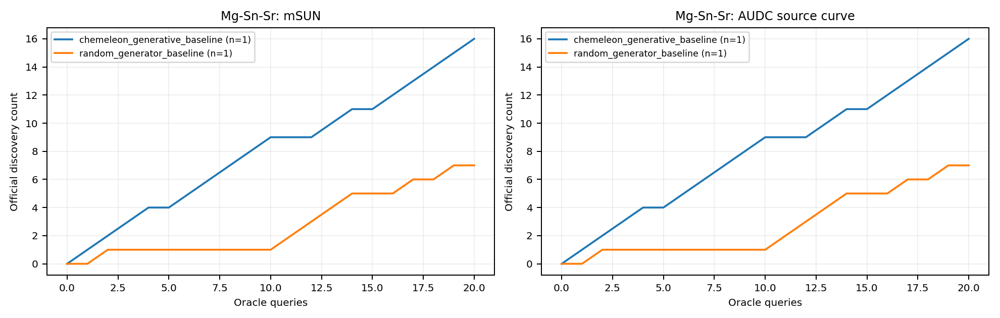

# Verified Chemeleon recovery and partial paired development report

The single authorized recovery completed successfully on 19 October 2026 at
22:30 Singapore time. All four generation batches finished, followed by all
20 oracle queries. This is **2 of 36 baseline units**, not a complete M2
comparison. No additional experiment was started when receiving these results.

| Method | System | Seed | B | mSUN@20 | Official AUDC | Driver wall seconds |
| --- | --- | --- | --- | --- | --- | --- |
| Random | Mg-Sn-Sr | 17 | 20 | 7 | 55.5 | 952.717 |
| Chemeleon | Mg-Sn-Sr | 17 | 20 | 16 | 161 | 15767.025 |

For this single paired system/seed/budget only, the official MADE implementation
reports Chemeleon AF vs Random = 2.375 and EF vs Random = 2.2857142857142856.
These are official discovery-curve metrics, not wall-time speedups or overall
method estimates. Chemeleon's driver took about 262.78 minutes. Do not infer
performance across other systems or seeds, or claim experimental laboratory
validation of generated materials.

## Evidence and independent verification

Source: [run 39234974449, job 118001953048](https://github.com/raymondtu1230-sudo/Group-Project-6-Auto-Research-for-Materials-Discovery/actions/runs/39234974449/job/118001953048),
fixed revision `3e07d9f0f35a5d0bc21321c2044f798e9ab1a16a`, attempt 5001.
The job completed with return code 0. Its first query checkpoint was recorded
at 22:25:53 Singapore time; the completed result was recorded at 22:30:02.
The subsequent report job passed and the wider sweep was skipped as requested.

- `raw_artifact.zip` is unchanged artifact 12194049480. SHA256:
  `17e1747473b60df105aca6de4f2f18449188122ac768e7747c1538b8cedb4c79`.
- `upstream_report.zip` is unchanged artifact 12194876393. SHA256:
  `945e5fb7ffd694c1c8b8e96bb1b70f95d12cfb50c185db082a4e18985a05a703`.
  It scores Chemeleon alone because that workflow did not rerun Random.
- `github-job-logs.zip` and `github-jobs.json` preserve actual job evidence.
  `source-ci-jobs.json` confirms that source revision's acceptance CI
  [39234974006](https://github.com/raymondtu1230-sudo/Group-Project-6-Auto-Research-for-Materials-Discovery/actions/runs/39234974006)
  passed its contract, lint, installation and original smoke steps.
- `provenance.json` records all raw-file checksums and the independent review.
  All 69 recorded M1 source hashes match the fixed source. The capture source
  hash matches. Resolving the original Hydra interpolation reproduces the
  saved resolved configuration, including CPU, pool 1024 and batch size 256.
- Raw trajectory length, final state query count and official history all
  confirm the complete sequence 1..20. M2's unchanged `evaluate.py` and MADE's
  unchanged official metric implementation were executed offline at the source
  revision. Two real runs were accepted with no validation findings.
- Random is referenced from the [previously verified package](../20261019-random-gate/README.md),
  with its original hash checked. It was neither rerun nor counted twice.
  Protocol settings match exactly. Both saved reference snapshots contain
  194 entries and share canonical SHA256
  `9ea6bd2159f2a96e323b64cb4b83423b7ebdf7b4d0f7825b3e51ce041cacdb10`.

`per_run.csv`, `per_system_summary.csv`, `per_method_summary.csv`,
`validation.json` and both curve files are the independently generated paired
report. Only repository-relative source labels were normalized in `per_run.csv`;
all numerical outputs are unchanged. Curves were visually inspected.
Method-level aggregate means and standard deviations remain blank because each
method has only one of its 18 required development units. Single repeats have
no sample standard deviation. No held-out test split was run.



## Costs, failure retention and remaining scope

Each successful unit records USD 0 in known model/API inference fees. Hardware,
electricity and charges for interrupted attempts are unmeasured; this is not a
zero-total-cost result. Original null LLM calls/tokens/costs remain null. The
upstream metadata's `total_cost_status=complete` refers to its recorded fee
accounting, not comprehensive economic cost.

The original [timeout/cancellation audit](../20261019-chemeleon-timeout/README.md)
retains both failed attempts and available logs. Those attempts have no complete
scientific result and are excluded from accepted scores; their observed compute
and missing cost fields remain explicit. The recovery consumed the authorized
single retry. No further retry or dispatch was performed.

Still missing: 34 baseline units and 18 frozen `m1_full` development units,
plus the team-dependent routing-off ablation and final comparisons. The full
method requires the other members' integration and the 25 October freeze;
`m1_baseline` is not a substitute. No active scientific work remains in the
monitored recovery workflow. PR #2 remains unmerged and both branches remain.

## Reproduce the offline paired review

Use revision `3e07d9f0f35a5d0bc21321c2044f798e9ab1a16a` and the locked MADE
environment. From the repository root:

```bash
python - <<'PYCODE'
from pathlib import Path
from zipfile import ZipFile
root = Path('M2/results/review-20261019')
for method, archive in (
    ('random', 'M2/verification/20261019-random-gate/raw_artifact.zip'),
    ('chemeleon', 'M2/verification/20261019-chemeleon-recovery/raw_artifact.zip'),
):
    with ZipFile(archive) as source:
        source.extractall(root / method)
PYCODE
cd M1/MADE
uv sync --locked
uv run python ../../M2/evaluate.py \
  --results-root ../../M2/results/review-20261019 \
  --output ../../M2/results/reproduced-paired-review --split dev --allow-partial
```

Select an empty output directory. Offline evaluation does not require a key,
call an oracle or start model sampling.
